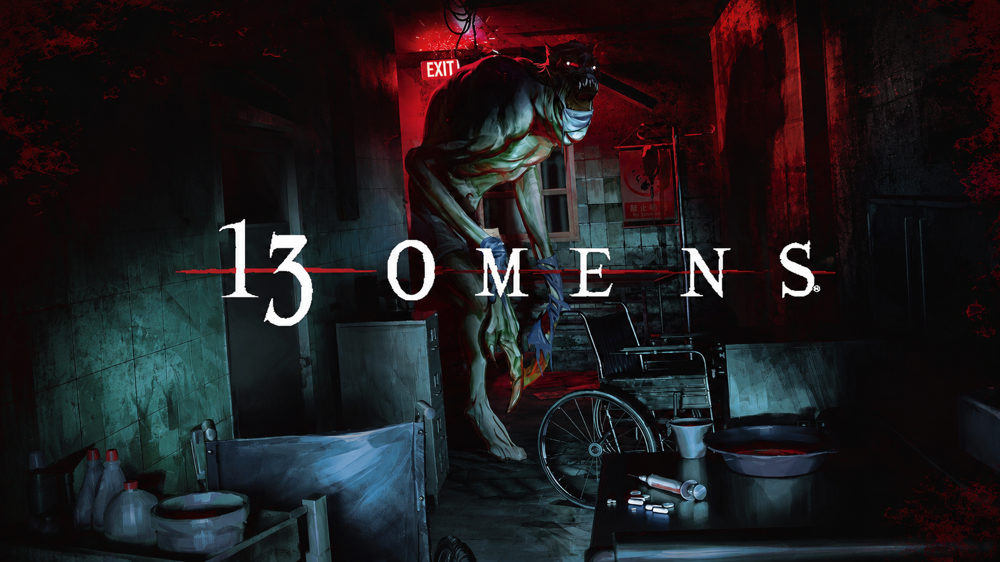
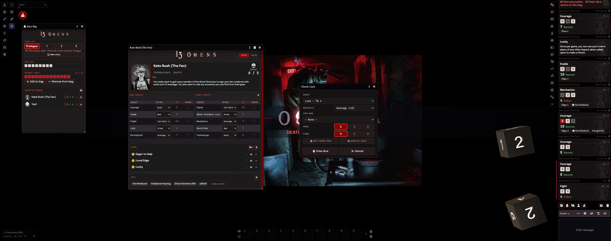

# 13 Omens — Foundry VTT System (unofficial)

*[Lire en français](README.fr.md)*





> **This system was built entirely with AI assistance** (Claude, Anthropic), directed by SebsokK. If that's a problem for you, nobody's forcing you to use it.

Foundry VTT V13/V14 system for the narrative horror RPG **13 Omens** (Paizo Inc., preview PZO62000E / PZO64001E). Not affiliated with Paizo Inc.

## Installation

**From Foundry**: *Game Systems → Install System*, then paste this manifest URL:

```
https://raw.githubusercontent.com/SebsokK/omens13/main/system.json
```

**By hand**: copy the `omens13/` folder into `Data/systems/omens13` of your Foundry user data, restart Foundry, and create a world with the **13 Omens** system.

Compatible with Foundry V13 and V14.

## Features

### Character sheet
- **5 Core Aspects and 5 Story Aspects**: pick a Rating and the TN is filled in. Story Aspect names are set in one dialog (they change with every story). Click an Aspect row to make a Check.
- **Strain** on each Aspect: a Strained Aspect always rolls with at least one Flaw.
- **Perks**: tick the ones the character owns (they move to the top), **hide** the ones not chosen (greyed at the bottom, collapsible from the section header). Click a Perk's name to post it to chat; edit and delete appear on hover; the description unfolds below.
- **Gear** as tags: click an item to make a Check with it, right-click to rename it, mark it **broken or lost** (greyed and struck through, kept in case it gets repaired or found), or delete it.
- Traits, Goal and Notes with Foundry's rich text editor.

### NPC sheet
- A light sheet to put an NPC on the scene: portrait (also used for the token), name, role, goal, and a page of notes. NPCs don't make Checks and don't appear in the Dice Bag.

### Checks
- The Check window lets you choose the **Aspect**, the **difficulty**, the **item used**, **Edges and Flaws** (0/1/2 buttons), and two toggles: **Facing Evil** (the Host adds an Omen Die to the Check) and **Harmless Check**.
- Mandatory Flaws are applied for you: Strained Aspect, and 3 Wounds or more (a separate source).
- An intact item gives an Edge, a broken one a Flaw.
- Dice are drawn at random from the shared bag, the two highest or lowest are kept, and the result is compared to the TN. An Omen Die at or under the current Act causes a Wound (one per Check at most), or a Strain on a Harmless Check.
- The chat card shows every die (Safe or Omen, from the bag or added by Facing Evil); the Omen Die that wounds glows red.
- **Dice So Nice** supported: Safe Dice in black and white, Omen Dice in red.

### The Dice Bag
A floating panel (sack button, or **Ctrl+Shift+D**) shared by the whole table:
- the dice in the bag (8 Safe Dice, plus the Omen Dice added by the Host) and the Host's Reserve of 13 Omen Dice;
- the current **Act** (Prologue, 1, 2, 3), set by the Host;
- the Wounds of each character, and the dice really sitting in front of them.

Any player can draw dice, even when the Host is offline. Adding or removing Omen Dice, changing the Act and choosing the characters are Host-only.

### Cheat Death and Death
- **Cheat Death** (from the Check card, or the Dice Bag): the Wound is replaced by a Safe Die taken out of the bag for good, and the Omen Die goes back into the bag. Once per Act for the whole table, once per story per character, and only if the roll included a Safe Die. Can be undone.
- At the last Wound, the character can still Cheat Death, or **Succumb**: all the dice in front of them return to the bag and they leave the story.
- **Group size** (p.27): the death threshold follows the number of characters chosen in the Dice Bag (6 Wounds with 1 character, 5 with 2, 4 with 3 or 4, 3 with 5, 2 then 3 with 6).

### Atmosphere
- When the Host moves to the next Act, every player gets a full-screen title (*"Act II — The evil reveals itself."*).
- Dice drop onto the chat card one by one, the wounding Omen Die pulses, the Wound banner shakes.
- A dying character pulses in the Dice Bag.
- Themed pause screen, token bar for Wounds.

## Running a story

1. Create the characters (or pregens) and give each player ownership of theirs.
2. In the Dice Bag, use the **👥** button to choose the characters playing this story.
3. Play the Prologue, add the first Omen Die to the bag at its end, then move through the Acts as the Omen Dice come into play.
4. To play the story again, click **New story** in the Dice Bag: the bag is reset and every character is fully restored (Ratings, Perks and Gear are kept).

## Left to the Host

These rules are narrative calls and are not automated: **Valiant Sacrifice**, **Risky Checks** (Strain, lost Gear or Perk on a failure), the free Strain removal for groups of 3, Borrowed Time and Lingering Spirits.

## Known limitations

- No private, GM-only or blind roll modes for Checks yet.
- Fonts are loaded from Google Fonts: offline, Foundry falls back to system fonts.
- If a player can't see a character in the Dice Bag, give them at least Observer permission on it.

## Changelog

See [CHANGELOG.md](CHANGELOG.md).

## Credits

13 Omens is a creation of Paizo Inc. This Foundry system is an unofficial tool made by a fan for their own table; it does not reproduce any protected rules text beyond the game mechanics needed for it to work.
